# 基于FPGA的16通道数据采集系统

版本日期：2026-10-28。

# 摘要

针对结构振动及相关电压信号的多通道采集需求，本作品设计了基于Zynq的16通道数据采集系统，由模拟前端、双AD7768、可编程逻辑、处理器应用和PC上位机组成。团队自主开展电路、PL、PS及上位机开发，围绕信号调理、数据组织和网络交互建立完整的工程设计。

主采集链设置电压与IEPE相关输入选择，采用约4mA恒流激励设计、四阶模拟低通和差分驱动。PL接收双ADC串行数据，通过共同交接与通道映射，将24位转换码组织为32位缓存字，经FIFO和自定义AXI写通路进入DDR；PS采用standalone应用，负责命令控制、半区轮询读取和UDP上传，PC端设置配置、波形及保存等操作入口。按32.768MHz输入配置推导采样率为每通道51.2kSPS；温度测量另设RTD调理和MCU复用支路。

作品已形成电路与PCB设计、PL逻辑、PS应用和上位机软件。研制记录展示了信号响应、网络上传与文件保存操作；工程资料包含串行接收、FIFO/AXI和PS处理的数字仿真、程序检查，以及ARM应用编译、PL综合布线和启动镜像打包结果。系统以模块化电路和分层数据通路组织采集、缓存、传输与PC交互，为多通道信号研究提供工程基础。

# 第一部分  作品概述

## 1.1 功能与特性

系统主采集链按16路设计，面向电压信号及IEPE传感器相关信号，包含输入选择、恒流激励、低通调理、差分转换和数据上传。双ADC数据由PL接收并组织为16路数据组，经FIFO与DDR缓存后由PS打包发送。启动、停止和通道属性具有对应控制程序，PC端设置参数配置、波形查看和文件保存等操作入口。

研制记录展示了正弦输入、IEPE敲击与摇晃、压力传感器按压，以及保存和导出操作。主采集链采用固定采样配置，独立RTD支路采用复用测量电路。

## 1.2 应用领域

本作品面向矿区及施工扰动条件下的结构振动研究，也可作为机械振动、结构模型和传感器实验中的多通道采集原型。电压输入便于连接信号源和外部调理设备，IEPE相关输入设计面向振动传感器，网络接口便于把采集单元与PC操作端分别布置。

压力相关信号可结合相应传感器与调理方式开展联调；独立RTD支路提供温度信息接入的电路基础。模块化的信号调理、采集与网络接口便于围绕不同传感器组织实验。

## 1.3 主要技术特点

系统采用模拟前端、双ADC与Zynq协同结构：前端将输入选择、恒流激励、四阶低通和差分驱动衔接，PL承担串行接收、双片交接及通道映射，PS承担命令与网络处理，PC负责操作交互。

数据通路保留24位转换码并左对齐为32位字，以4096B块写入DDR双半区。采集字序、缓存块和UDP字节位置具有明确的对应关系，便于接收端按通道组织数据。温度调理与主ADC链分别组织，采用各自的采样及数据处理方式。

硬件、电路控制、串行接收、缓存写入和网络交互相互衔接，形成从传感器相关输入到PC操作端的分层工程架构。

## 1.4 主要性能指标

| 指标 | 数值与口径 |
| --- | --- |
| 主采集通道 | 16路设计 |
| 数据格式 | 24位转换码，32位缓存字 |
| 每通道采样率 | 51.2kSPS，按32.768MHz输入配置推导 |
| 输入范围 | ±10V，设计目标 |
| 整机准确度 | ±1%，设计目标 |
| 整机噪声 | 峰峰值＜200μV，设计目标 |
| IEPE激励 | 约4mA，设计值 |
| 模拟低通 | 四阶，理想截止约25kHz |

## 1.5 主要创新点

（1）将16路电压/IEPE调理、双ADC与Zynq协同采集集成为统一的自主软硬件工程。

（2）围绕双片数据共同交接、通道映射和FIFO—DDR双半区，组织可逐级核对的数据通路。

（3）协同设计板端控制、网络字节接口和PC交互，主采集与独立温度复用电路分别组织，便于后续标定及功能扩展。

## 1.6 设计流程

技术流程依次包括需求与接口定义、电路和PCB设计、双ADC接收与映射、FIFO/DDR缓存、PS控制与网络、PC交互及系统联调。相应工程资料按模块保存，并配套数字仿真、程序检查、ARM应用编译、PL综合布线和启动镜像打包记录。

# 第二部分  系统组成及功能说明

## 2.1 整体介绍

本系统面向结构振动及相关电压信号的多通道采集，主链路按16路设计。输入信号经过恒流激励或电压输入选择、模拟低通和差分驱动，进入两片AD7768；Zynq可编程逻辑侧负责时钟与引脚控制、串行接收、通道映射和缓存，处理器侧负责控制命令与网络上传。

本项目由团队自主开发电路、PL、PS与上位机，并采用FPGA基础IP、SDK/BSP、lwIP及PC运行库提供底层支撑。

图2-1给出信号与控制关系。主数据经PL接收模块、FIFO和自定义AXI写通路进入DDR，再由6236A standalone应用读出并上传PC。控制命令沿PC、PS GPIO、PL的方向作用于采集使能和通道属性。PC端使用YE7600，并保留备用Qt程序用于联调。

温度相关电路采用独立支路：三线RTD输入经OPA4171调理、双CD4067复用后接入GD32F103C8T6。该支路与双AD7768主链路分别组织，各自承担温度调理与主信号采集的电路功能。

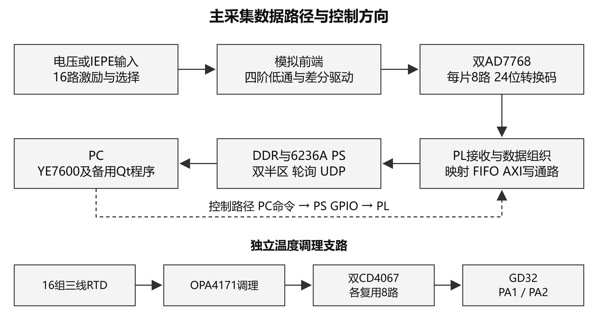

图2-1 主采集数据路径与独立温度调理支路

## 2.2 硬件系统介绍

### 2.2.1 硬件整体介绍

控制器选用xc7z020clg400-2，开发环境为Vivado 2018.3。PL接收转换数据，经PS的HP接口写入DDR[1]；PS从内存缓冲区读取并通过以太网发送。硬件包括24V输入电源、两组8路模拟调理、双ADC、控制平台及独立温度调理与复用电路，采集板采用6层PCB设计。

ADC_1、ADC_2分别采用U3、U12的AD7768BSTZ，共提供16路差分输入。串行帧为32位[2]，逻辑保留其中24位转换码，低位补8个零形成32位缓存字。24位用于描述转换码格式，32位用于描述缓存字宽；工程指标另按设计目标、配置推导和器件标称列示。

### 2.2.2 机械设计介绍

系统按采集单元、控制平台和PC操作端组织安装关系，外部连接包括输入信号、供电与网络通信。

### 2.2.3 电路各模块介绍

#### 2.2.3.1 电源与基准

电源电路按24V输入组织模拟、数字及接口电源。ADC参考器件为ADR444BRZ，标称4.096V[3]，原理图网络名为AVCC+4V，经滤波连接参考输入。图中的网络标签用于识别电源与参考支路。

图2-2按主要电源与参考支路说明连接。DVCC+24V经L84形成AVCC+24V滤波支路；AGND与DGND经0Ω电阻连接。U122采用反相接法形成负电源前级，ADC基准与RTD调理参考分别组织。图中电源名表示设计网络。

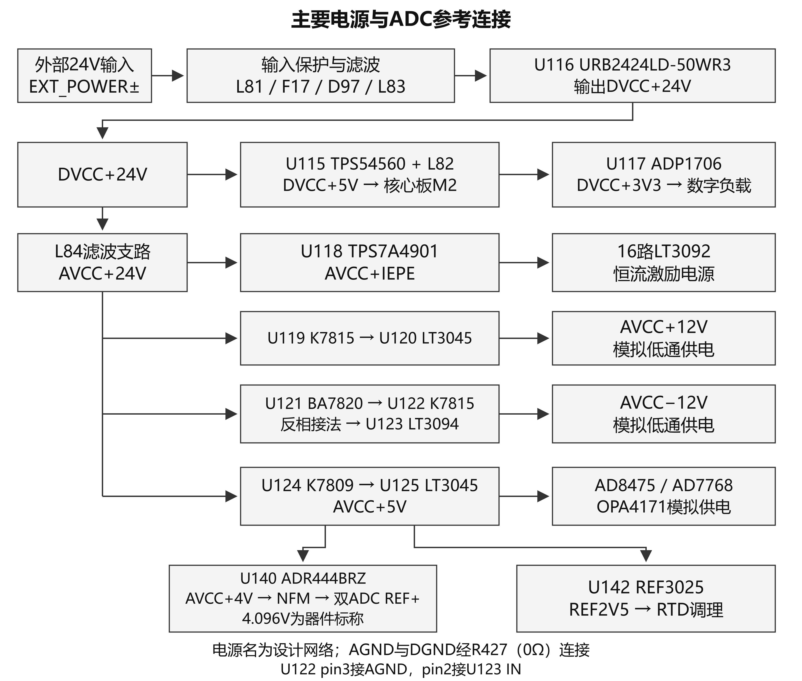

图2-2 主要电源与ADC参考连接

#### 2.2.3.2 恒流激励与输入选择

每通道设置LT3092恒流源及继电器相关选择电路。SET端120kΩ、OUT端300Ω的标称组合对应约4mA的激励设计[4]。通道属性由PS GPIO传入PL，组织电压与IEPE相关输入选择。

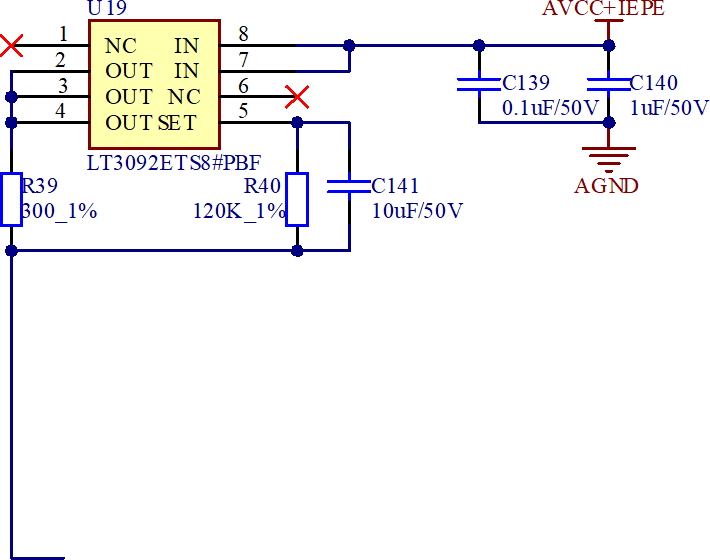

图2-3 恒流激励电路（研制报告原图）

#### 2.2.3.3 四阶模拟低通

每路由两级二阶Sallen-Key电路串联形成四阶低通。以CH1为例，第一级为4.99kΩ、6.81kΩ及1.2nF、1nF，第二级为1.43kΩ、3.4kΩ及8.2nF、1nF。采用标称元件的理想模型，推导总截止频率约25.07kHz[5]。该数值对应电路模型的理论计算。

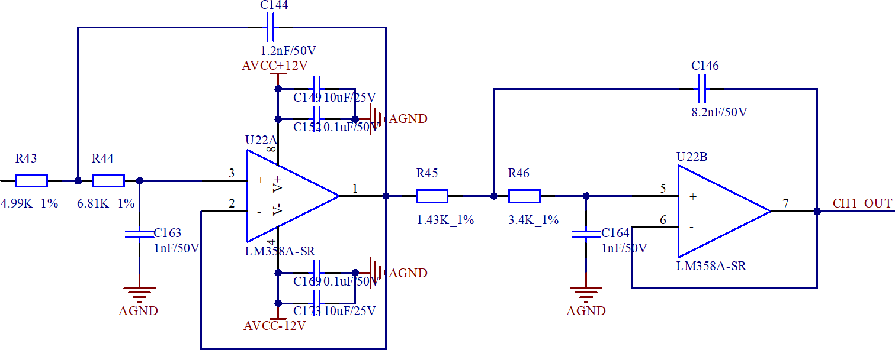

图2-4 两级二阶低通电路（研制报告原图）

#### 2.2.3.4 单端转差分与ADC接口

滤波输出CHx_OUT进入AD8475差分驱动，采用0.4倍输入端[6]；输出网络连接对应AD7768差分输入，共模端接ADC共模网络。图2-5标示从低通输出、差分驱动到ADC输入的连接路径。

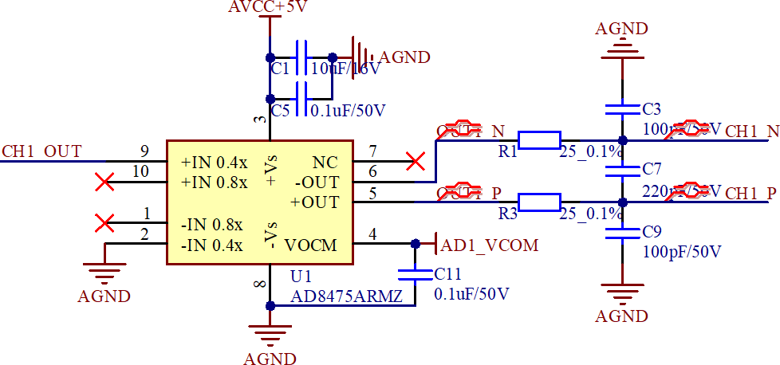

图2-5 单端转差分电路（研制报告原图）

#### 2.2.3.5 双ADC与控制平台连接

图2-6给出双ADC与PL的接口方向。各片DOUT[7:0]、DCLK、DRDY经33Ω排阻进入核心板接口，MCLK及配置、复位、SYNC_IN控制分别连接。U3的AIN0至AIN7依次接CH7、CH4、CH3、CH8、CH2、CH6、CH5、CH1；U12依次接CH15、CH11、CH16、CH12、CH14、CH9、CH10、CH13，各通道均为差分连接。

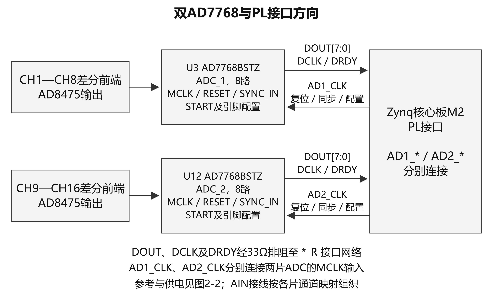

图2-6 双AD7768与PL信号连接

#### 2.2.3.6 温度调理与复用

16组三线RTD接口经OPA4171调理，进入两只CD4067的Y0至Y7，再由公共端接GD32F103C8T6的PA1、PA2。MCU连接复用选择和使能控制，设计参考器件为REF3030；温度调理电路采用分组复用测量结构。

图2-7中，两只CD4067共享选择和使能控制，各用Y0至Y7形成8路复用组。REF2V5用于RTD模拟调理，REF3030输出接MCU的VDDA，与主ADC的4.096V参考分别组织。图中按调理、复用和MCU输入顺序说明电路连接。

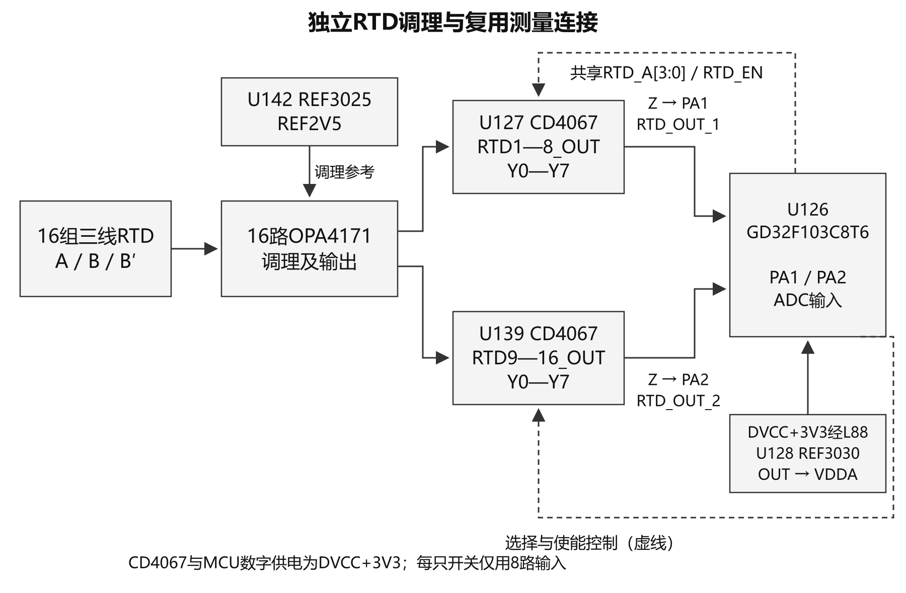

图2-7 独立RTD调理与复用测量连接（据已核原理图绘制）

## 2.3 软件系统介绍

### 2.3.1 软件整体介绍

软件分为PL逻辑、PS应用和PC软件。PL采用Verilog描述双ADC接收、交接与映射、FIFO及AXI写控制；PS为Xilinx SDK 2018.3中的6236A应用，以standalone 6.8 BSP和lwIP网络栈组织[7]。图2-9至图2-11分别说明ADC接收、缓存写入和PS轮询上传的功能关系。

PC端以YE7600 5.6.0.69为主程序，配套daqConfig配置工具，并保留备用Qt/C++采集程序。YE7600使用LabVIEW运行环境，daqConfig采用Qt。图2-8为研制阶段保留的上位机操作界面，展示波形、通道选择、连接和采集控件。

PC接收接口的功能设计按网络接收、应用头与样本解析、通道组织、物理量换算、显示、保存和分析划分环节。包布局采用6236A发送代码定义；字槽、通道索引与单位设置作为接收侧接口设计要素。

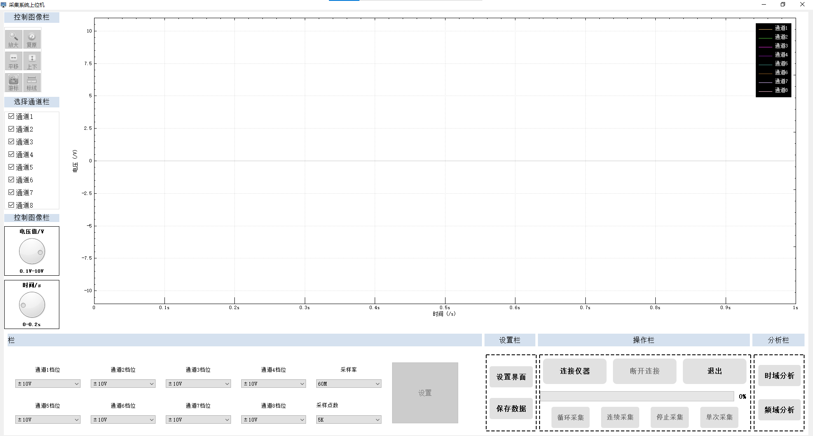

图2-8 上位机操作界面

### 2.3.2 软件各模块介绍

表2-1 关键模块输入与输出

| 模块 | 关键输入 | 关键输出或动作 |
| --- | --- | --- |
| ADC接收 | en、DRDY、DCLK、dout[7:0] | 固定引脚配置；8个左对齐字、rts |
| 双片交接 | 两片rts及16个采集字 | 锁存与共同ack；通道映射 |
| FIFO与FDMA | 写字、prog_full、AXI握手 | 4096B请求；DDR地址与边界通知 |
| 6236A主循环 | GPIO13、intr_flag、DDR | 交替读取半区；逐字节打包发送 |
| 命令回调 | UDP命令及属性参数 | 采集使能、16路属性、命令应答 |
| PC处理 | 载荷、通道、单位及文件设置 | 波形交互、数据组织及保存操作入口 |

#### 2.3.2.1 ADC接收与引脚配置

图2-9展开单片接收与双片交接。en有效后，单片状态机依次执行复位、释放、固定配置和SYNC_IN控制，随后等待DRDY下降沿。DRDY、DCLK进入PL时经寄存器采样与边沿检测；读取32个DCLK下降沿对应的8路串行帧，取低24位并补零，在交接时提出rts。

引脚配置为FILTER=0、MODE=1010、DEC=01。按32.768MHz输入及PLL50倍频、125分频计算，MCLK为13.1072MHz；fast模式和64倍抽取时ODR=MCLK/256，即51.2kSPS/通道；DCLK=MCLK/4，即3.2768MHz[2]。这些数值为该时钟输入条件下的配置推导。接收状态机按复位、配置、同步控制和串行读取组织流程，RESET状态设置为64个100MHz PL周期。

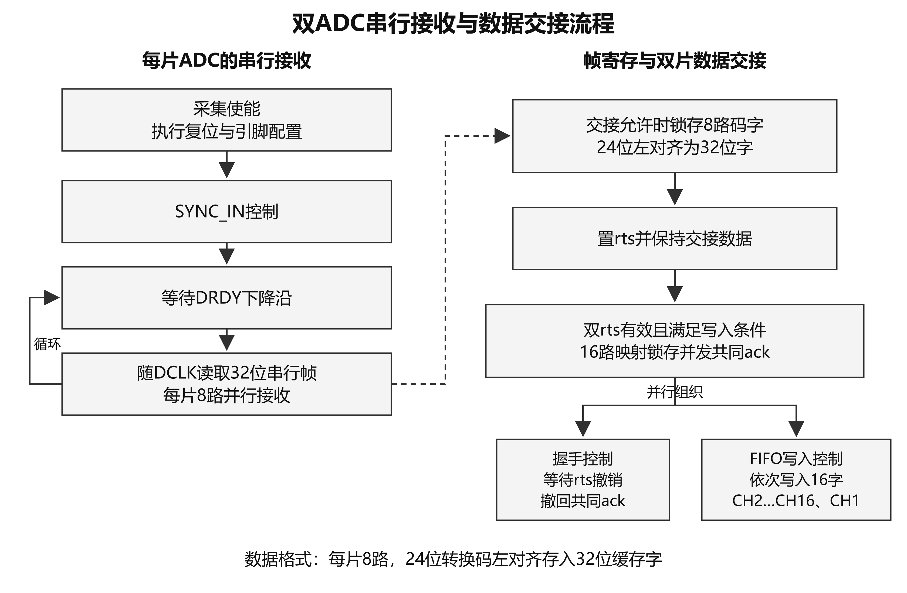

图2-9 双ADC串行接收与数据交接流程

#### 2.3.2.2 双片交接通道映射与FIFO

rx_board_data等待两片rts均有效后锁存16路数据，发出共同ack，并等待两片撤销请求。采集字通过保持寄存器和请求应答交接，组织为供后级缓存使用的16路数据组。

逻辑通道映射与原理图AIN连接相对应。FIFO写入次序为CH2至CH16、最后CH1；PS保持DDR字序；按逻辑定义，组内第16个字对应CH1，第1至15个字对应CH2至CH16。FIFO配置为32位×4096字、标准读模式[8]，prog_full阈值为1024字；逻辑结合FIFO状态、读写计数和16字空间预留组织数据交接。

FIFO读取与AXI发送分为读请求、数据锁存和发送三个阶段。标准FIFO的输出由保持寄存器承接，再由AXI发送状态控制数据字、有效信号与接收握手，使缓存读取和总线发送具有清楚的时序边界。

#### 2.3.2.3 自定义AXI写通路

图2-10说明FIFO至DDR的块写入过程。阈值触发1024字、即4096B写请求，32位AXI总线按4个256拍突发组织。每个突发通过WLAST标识末拍，4096B请求按四个突发的成功写响应组织提交，块地址随请求提交推进。

AXI发送状态在背压期间保持WVALID、WDATA及WLAST，逐突发等待B响应，并以BID匹配、BRESP为OKAY作为推进条件[9]。数据握手、响应确认和请求提交分别定义，使AXI传输与DDR块地址管理相互衔接。

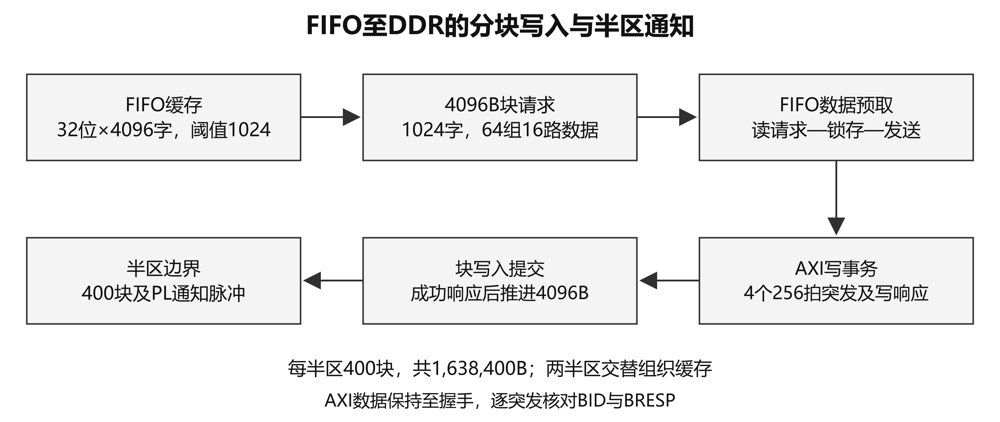

图2-10 FIFO至DDR的分块写入与半区通知

#### 2.3.2.4 DDR双半区与PS轮询

主缓冲区为0x30000000至0x3031FFFF，分成两个各1,638,400B的半区，后半区起点为0x30190000。每组16路×4B为64B，每块含64组，每半区含400块、25,600组。若实际ODR为51.2kSPS，则半区容量对应0.5s、整区对应1s。

图2-11给出6236A主循环。PS处理网络输入后轮询GPIO13，按intr_flag交替选择半区；读取前调用Xil_DCacheFlushRange，BSP实现执行缓存行清理与失效[7]。运行状态与通知电平共同控制半区处理，每半区按3200包组织上传，完成后回到网络输入处理。

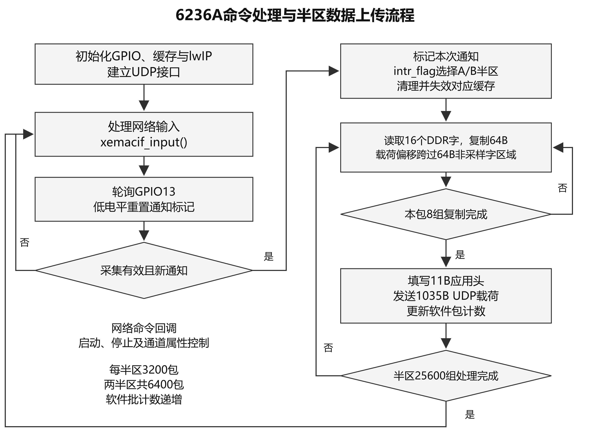

图2-11 6236A命令处理与半区数据上传流程

#### 2.3.2.5 UDP字节布局与接收接口

图2-12和表2-2采用载荷0基下标。每包0至10为应用头，之后8个128B组各包含64B从DDR复制的数据字和64B非采样字区域；首组复制区为11至74，末组为907至970。复制区合计512B，非采样字区域合计512B，总载荷为1035B，两类区域按组交错组织。

设组号g为0至7、组内字槽j为0至15，字首偏移为11+128g+4j；每字4B按低字节在前发送。按PL输出格式，每字为24位转换码左对齐、低8位补零。每包从DDR复制8组、每组16字，该字槽定义和码字格式用于接收接口设计。

按51.2kSPS配置推导值、16路及每路4B缓存字计算，数据字流预算为51,200×16×4=3.2768MB/s；按每包8组计算为6400包/s，UDP应用载荷预算为6400×1035=6.624MB/s，MB按十进制计。该理论预算包含应用头及非采样字区域，链路层开销另计。

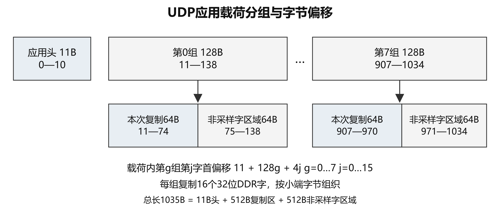

图2-12 UDP应用载荷分组与字节偏移

表2-2 当前UDP载荷字节布局

| 载荷0基偏移 | 长度 | 发送布局 |
| --- | --- | --- |
| 0—7 | 8B | 固定前缀40 00 05 04 00 00 FF 00 |
| 8；9—10 | 1B；2B | 软件批计数；包计数低字节、高字节 |
| 11+128g 至74+128g | 8×64B | g=0…7，每组16个32位DDR复制字 |
| 75+128g 至138+128g | 8×64B | 按组交错的非采样字区域 |
| 0—1034 | 1035B | 11B应用头、512B复制字、512B非采样字区域 |

#### 2.3.2.6 命令执行与PC功能组织

0x01和0x00经GPIO74控制启动、停止，0x0A控制16路属性。命令回调按接收长度和数据段组织参数读取，并以运行状态管理启动操作；重新启动时，PS从A半区组织读取。PL按已发起写请求的提交状态协调FIFO及地址复位，本版本采用固定采样配置。

PC接口设计围绕采样字槽、通道索引、24位码值、前端与传感器单位以及文件组织建立功能划分。显示抽点、时间轴和频谱参数属于上位机的数据呈现与分析设计内容。

# 第三部分  完成情况及性能参数

## 3.1 整体介绍

本作品已形成16路主采集通路的电路与PCB设计，以及双AD7768接收、FIFO与DDR写入、PS控制和UDP上传程序。板端采集应用为6236A standalone；PC端包括YE7600主程序和备用Qt上位机。

研制记录包含正弦输入、IEPE传感器敲击与摇晃、压力传感器按压、网络上传及文件保存操作。工程成果按电路与PCB、板端程序、上位机交互、数字验证及构建交付分类展示。

## 3.2 工程成果

### 3.2.1 机械成果

系统安装关系与功能模块相对应，由采集板、控制平台以及外部供电、信号和通信连接构成。

### 3.2.2 电路成果

已形成的电路与PCB交付物覆盖24V输入电源、16路激励与输入选择、四阶低通、AD8475差分驱动、双AD7768转换，以及独立RTD调理和MCU复用支路。主ADC方案在原理图、PCB器件对象与BOM中可相互对应。

电路资料按主要功能模块组织，形成原理图、PCB对象、器件清单和网络连接的对应关系，便于从输入调理追踪至转换、控制和通信接口。

### 3.2.3 软件成果

PL和PS交付物已形成从双ADC接收到UDP上传的程序路径。工程资料包含串行接收与通道映射逻辑、FIFO/AXI写通路、6236A应用、ARM链接结果、PL布线结果、硬件交接文件及启动镜像，各类文件配套保存版本与内容核对记录。

PC软件成果包括YE7600 5.6.0.69、daqConfig配置工具及备用Qt程序。操作界面见图2-8，研制阶段传感器响应界面见图3-2、图3-3，配套材料记录了波形显示、保存与导出操作。

表3-1 软件与启动交付物

| 交付物 | 工程内容 | 资料形式 |
| --- | --- | --- |
| PL逻辑与PS应用 | 双ADC接收、映射、FIFO/DDR和UDP路径 | Verilog、C源码及构建文件 |
| YE7600 5.6.0.69 | 主上位机及daqConfig配置工具 | 发布包、配置及研制阶段操作资料 |
| 备用Qt程序 | 采集操作与数据交互程序 | Qt/C++发布包 |
| 启动镜像 | FSBL、PL配置及应用组合 | bit、HDF、ELF、BOOT及内容核对记录 |

## 3.3 特性成果

图3-1至图3-4为研制阶段保留的联调记录，量纲、游标和界面信息沿用原图。表3-2汇总主要功能与研制资料，表3-3按设计目标、配置推导和器件标称说明指标。

### 3.3.1 正弦与传感器响应

研制报告5.1记录名义1、5、10、15、20kHz正弦输入，标注采样条件为51.2kHz，并展示NI采集卡与本板的分析界面。图3-1取自本板名义1kHz输入的研制阶段记录，呈现相应时域曲线和频域分析界面。

图中的坐标量纲、游标和软件设置按研制记录保留，用于展示该次输入条件下的软件观察界面。

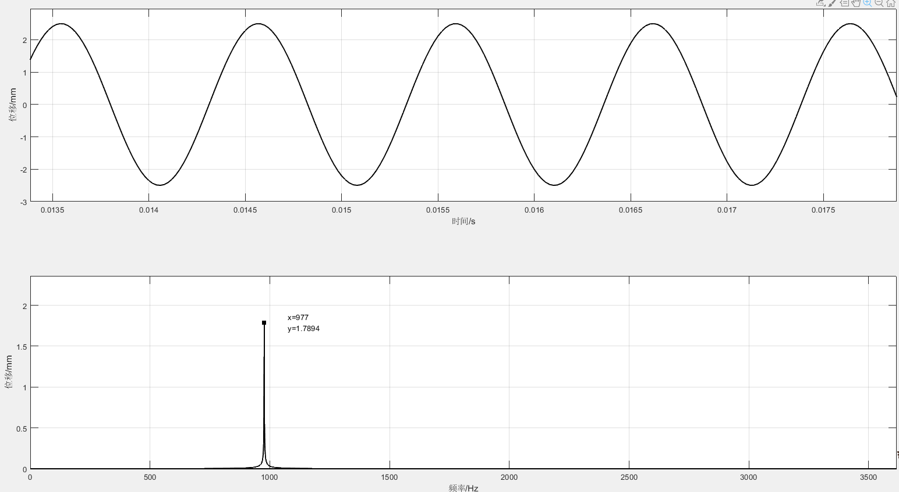

图3-1 名义1kHz输入的研制阶段分析界面

研制报告5.3记录IEPE传感器的敲击、摇晃以及压力传感器的手动按压。图3-2展示报告所述YE7600中的两次敲击响应，图3-3展示与手动按压操作关联的曲线，反映传感器相关信号的接入、联调与显示过程。

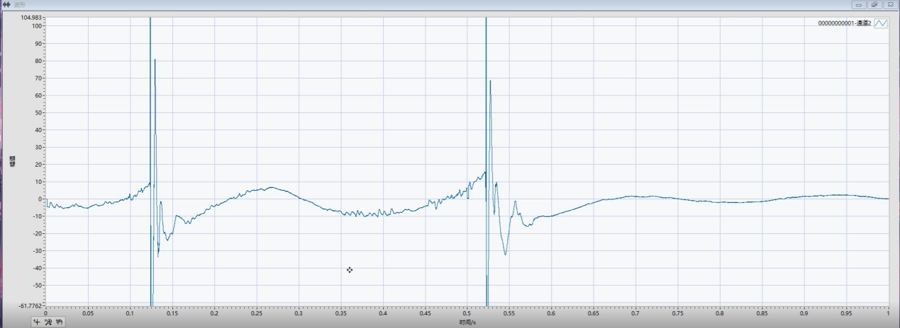

图3-2 IEPE传感器敲击响应界面

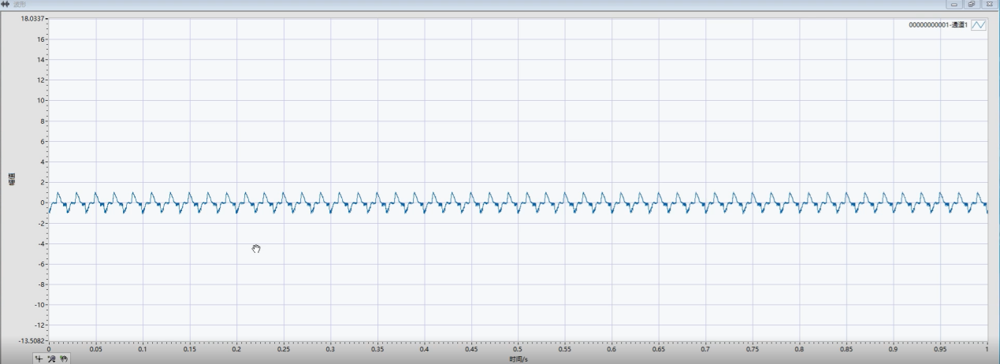

图3-3 压力传感器按压响应界面

### 3.3.2 网络上传与保存交互

图3-4为研制阶段UDP上传记录，源地址为192.168.100.10，目的地址为192.168.100.100。图中应用载荷Len=1035、帧长度1077，载荷长度与发送代码中的1035B配置相对应。

研制资料包含TDMS保存、CSV导出及连续/间隔保存的操作界面。PC端以波形显示、采集控制、文件存储及分析入口组织交互，使网络数据与文件操作在同一软件界面呈现。

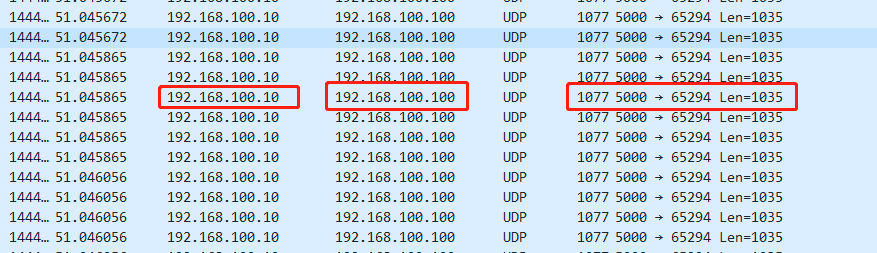

图3-4 研制阶段UDP上传记录

表3-2 主要功能与研制记录

| 功能 | 工程组织 | 已有资料 |
| --- | --- | --- |
| 主采集与上传 | 双ADC、FIFO、DDR和UDP分层处理 | 原理图、板端代码及信号响应界面 |
| 启停及通道属性 | GPIO控制与PS命令回调 | 程序实现、主机程序检查及研制操作记录 |
| IEPE与压力信号 | 输入选择、传感器接入和PC曲线显示 | 敲击、摇晃与按压响应界面 |
| 采样配置 | 固定引脚配置与PLL时钟组织 | FILTER、MODE、DEC及倍分频参数 |
| 保存与导出 | PC文件存储与数据导出交互 | TDMS保存、CSV导出操作资料 |
| 频域分析交互 | PC分析入口与频谱界面 | 研制阶段时域及频域分析图 |
| 温度电路 | RTD调理、CD4067复用与MCU输入 | 独立温度支路原理图和网络连接 |

### 3.3.3 性能指标及计算依据

表3-3按设计目标、配置推导、器件标称和工程实现列示指标。±10V、整机±1%和峰峰值小于200μV属于设计目标；采样率采用32.768MHz输入条件下的配置计算；模拟低通采用标称元件的理想模型。

24位描述ADC转换码，32位描述缓存字。IEPE激励电流来自电阻配置计算，ADC参考值采用器件标称；这些指标与电路、逻辑及发送布局分别对应。

表3-3 设计指标与工程参数

| 指标 | 数值或形式 | 类别 | 依据 |
| --- | --- | --- | --- |
| 主采集通道/码宽 | 16路；24位码左对齐32位字 | 电路与逻辑设计 | 双AD7768及缓存字定义 |
| 采样配置 | 51.2kSPS/通道 | 配置推导 | 32.768MHz输入、PLL50/125、fast/64倍抽取 |
| 输入范围 | ±10V | 设计目标 | 系统输入与前端设计口径 |
| 整机准确度 | ±1% | 设计目标 | 研制报告指标 |
| 整机噪声 | 峰峰值＜200μV | 设计目标 | 研制报告指标 |
| 模拟低通 | 四阶，理想截止约25.07kHz | 理论计算 | 标称R/C理想模型 |
| IEPE激励/参考 | 约4mA；4.096V | 设计计算/器件标称 | LT3092电阻配置；ADR444参数 |
| UDP复制布局 | 1035B载荷；8组×16个32位DDR字 | 代码实现 | 11B应用头及按组排列的数据槽 |

### 3.3.4 PL实现资源与工程构建

工程在Vivado 2018.3中完成综合与布线。表3-4列出该次实现的资源使用量；已设约束内建立裕量为1.692ns，保持裕量为0.036ns。资源、时序和生成文件与相应构建记录配套保存。

表3-4 PL实现资源占用

| 资源 | 使用/可用 | 占用率 |
| --- | --- | --- |
| LUT | 8621 / 53200 | 16.20% |
| 寄存器 | 13410 / 106400 | 12.60% |
| Block RAM | 136 / 140 | 97.14% |

### 3.3.5 数字仿真与程序检查

数字链路采用Vivado Simulator 2018.3组织串行接收、FIFO与FDMA的模块检查。激励包括数字ADC事件和AXI握手，按采集字、地址及提交事件记录结果。表3-5列出各类检查对象及其范围。

PS程序检查在Windows主机上使用人工内存和GPIO、缓存、UDP接口替身核对命令与复制行为；ARM应用另使用SDK配套工具编译链接。协议检查采用人工载荷与独立码型，按复制字和符号边界进行对应。

表3-5 数字仿真与程序检查

| 对象 | 执行内容 | 资料范围 |
| --- | --- | --- |
| FIFO与AXI写通路 | 15组共同激励；整环800请求、819200字逐字对应 | 数字模型中的数据、握手、地址与提交事件 |
| 启停状态 | 10组独立场景覆盖请求、AXI传输和通知阶段 | 接收、请求提交及启停状态关系 |
| ADC串行接收 | 40次输出检查；3次启停RESET状态均64拍 | 数字帧与24位左对齐输出格式 |
| PS状态与命令 | 25条主机行为断言 | 人工内存及接口替身下的程序行为 |
| 载荷与码字 | 14条人工载荷检查、2176个复制字复算 | 发送布局、整数码型及正负边界 |

工程检查资料按源文件、构建输入、命令记录、数字激励和输出结果归档，使模块说明、程序产物与检查范围相互对应。

### 3.3.6 工程文件与启动交付

工程按模拟前端、ADC接收、FIFO与AXI写入、PS命令与上传、PC交互分模块组织。软件接口明确采集字格式、块大小、半区地址及UDP布局，构建交付包括PL配置、硬件描述、ARM应用和启动镜像。

各类交付文件保存身份与内容核对记录。硬件交接包内的PL配置与bit对应，BOOT按FSBL、PL配置和应用程序组织；构建交付见表3-6。

表3-6 工程构建与交付内容

| 交付类别 | 形成内容 | 工程关系 |
| --- | --- | --- |
| PL配置 | Vivado综合布线结果、bit文件 | 对应ADC接收、FIFO和AXI写通路 |
| 硬件交接 | HDF及PS初始化文件 | 包含硬件描述与937项PS参数对应记录 |
| PS应用 | 10个C文件编译链接形成ARM ELF | 沿用standalone BSP与库，应用独立构建 |
| 启动镜像 | BOOT及分区内容核对记录 | 复用原FSBL，组合PL配置和ARM应用 |

PS应用的10个C文件使用SDK 2018.3配套工具编译链接，沿用standalone BSP与库。链接文件配套保存代码、静态内存区和DMA半区的地址组织，便于按模块管理程序与采集缓存。

PL实现使用LUT8621/53200、寄存器13410/106400、BRAM136/140。资源和时序报告、路由检查点及生成文件共同构成该次工程构建记录。

bit、HDF、ELF及BOOT按对应关系归档。硬件交接文件保存PS参数与初始化内容，启动镜像沿用原FSBL和BSP相关配置，应用程序独立重建；启动分区与源产物的内容核对记录随工程保存。

# 第四部分  总结

## 4.1  可扩展之处

在现有模块化架构上，可进一步拓展采样配置、传感器类型和PC数据分析功能，围绕多通道输入建立更丰富的实验应用。数据组织可扩展通道、采样配置、单位和操作信息等元数据，便于将采集记录与后续分析连接起来。

独立RTD电路可继续向温度信息处理与综合显示方向扩展；硬件平台可结合具体应用组织供电、接口防护、安装结构及人机交互。扩展过程沿用电路、逻辑、程序和数据记录的模块化组织方式。

## 4.2  心得体会

多通道采集系统把模拟电路、数字逻辑和软件连接为一条完整的数据通路。器件选型确定设计基础，输入调理、参考电压、采样控制、缓存时序、网络解析和单位换算共同决定数据的含义。电路、PL、PS与上位机的自主开发，使这些接口能够在统一工程中统筹组织。

本作品带来的一个认识是，数据格式和接口定义应贯穿整个设计。24位转换码、32位缓存字、通道顺序及UDP字节位置分别承担明确作用。将码字、通道、单位和输入条件连接起来，能够使波形与频谱分析具有清晰的工程语义。

PL设计侧重并行接收、时序组织与缓存管理，PS程序侧重命令处理和网络上传，两者通过采集块、半区地址和控制状态建立联系。串行接收、FIFO读取、AXI握手和半区处理按模块划分，有利于在数字仿真与程序检查中逐级观察数据。

上位机同时承担操作交互和数据呈现。通道设置、采样配置、单位换算、文件组织及分析入口具有相互关联的作用。把这些信息与数据一并组织，便于从采集操作延伸到文件保存、波形观察和后续研究。

工程开发还需要将电路资料、模块源码、构建产物与研制记录配套保存。相同的数据格式和接口约定能够帮助不同模块协同工作，版本与内容记录则便于复现工程过程。由电路、逻辑、处理器和PC共同形成的系统视角，是本作品在多通道采集设计中的主要体会。

# 第五部分  参考文献

本文参考的平台、器件、软件库和接口协议资料如下。

[1] ADVANCED MICRO DEVICES. Zynq 7000 SoC Technical Reference Manual: UG585, 1.15[EB/OL]. (2026-02-06)[2026-10-22]. https://docs.amd.com/r/en-US/ug585-zynq-7000-SoC-TRM.

[2] ANALOG DEVICES. AD7768/AD7768-4: 8-/4-Channel, 24-Bit, Simultaneous Sampling ADCs with Power Scaling, 110.8 kHz Bandwidth, Rev. D[EB/OL]. (2025-04)[2026-10-22]. https://www.analog.com/media/en/technical-documentation/data-sheets/AD7768-7768-4.pdf.

[3] ANALOG DEVICES. ADR440/ADR441/ADR443/ADR444/ADR445: Ultralow Noise, LDO XFET Voltage References with Current Sink and Source, Rev. G[EB/OL]. (2018-04)[2026-10-22]. https://www.analog.com/media/en/technical-documentation/data-sheets/ADR440_441_443_444_445.pdf.

[4] ANALOG DEVICES. LT3092: 200mA 2-Terminal Programmable Current Source, Rev. D[EB/OL]. (2020-08)[2026-10-22]. https://www.analog.com/media/en/technical-documentation/data-sheets/lt3092.pdf.

[5] KARKI J. Analysis of the Sallen-Key Architecture: SLOA024B, Rev. B[EB/OL]. Texas Instruments, (2002-09)[2026-10-22]. https://www.ti.com/lit/an/sloa024b/sloa024b.pdf.

[6] ANALOG DEVICES. AD8475: Precision, Selectable Gain, Fully Differential Funnel Amplifier, Rev. D[EB/OL]. (2017-03)[2026-10-22]. https://www.analog.com/media/en/technical-documentation/data-sheets/AD8475.pdf.

[7] XILINX. OS and Libraries Document Collection: UG643, 2018.3[EB/OL]. (2018-12-05)[2026-10-22]. https://docs.amd.com/v/u/2018.3-English/oslib_rm.

[8] XILINX. FIFO Generator v13.2 LogiCORE IP Product Guide: PG057[EB/OL]. (2017-10-04)[2026-10-22]. https://docs.amd.com/v/u/en-US/pg057-fifo-generator.

[9] ARM. AMBA AXI and ACE Protocol Specification: ARM IHI 0022H.c, Issue H.c[EB/OL]. (2021-01-26)[2026-10-22]. https://documentation-service.arm.com/static/602a9df190ee6824a1e02b98.
